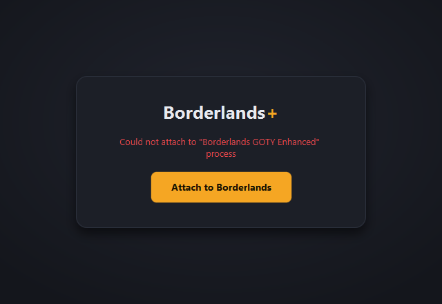
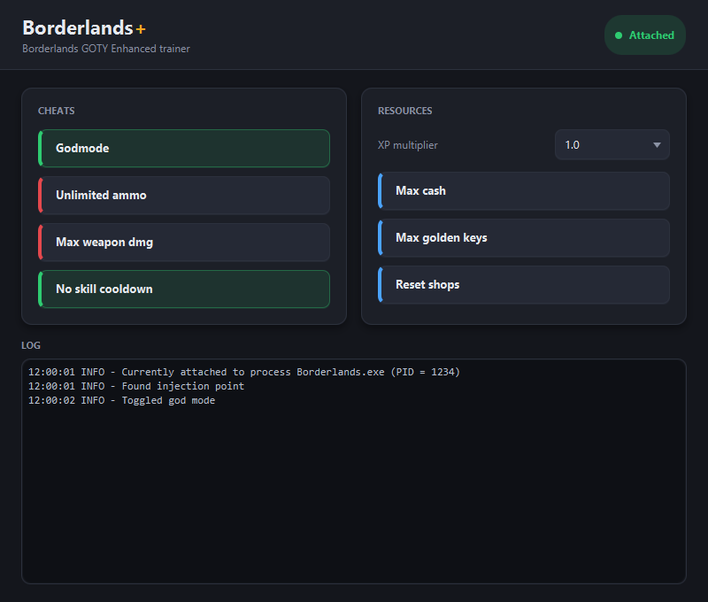

# Borderlands+

Trainer (hack) per **Borderlands GOTY Enhanced** con interfaccia JavaFX. Si collega al processo del gioco, modifica la memoria in tempo reale e permette di attivare i trucchi con un click.

> ⚠️ **Solo per uso in single-player e a scopo educativo.** Modificare la memoria del gioco in modalità online/multiplayer può causare problemi con il tuo account o con altri giocatori. Usalo a tuo rischio.

## Screenshot

| Schermata di collegamento | Schermata principale |
|:---:|:---:|
|  |  |

## Funzionalità

### Cheats (toggle ON/OFF)

| Funzione | Descrizione |
|---|---|
| **Godmode** | Salute e scudo vengono riportati continuamente al valore massimo. |
| **Unlimited ammo** | Le armi non consumano munizioni (costo munizione azzerato per ogni arma impugnata). |
| **Max weapon dmg** | Inietta del codice nel gioco che imposta il danno dell'arma a un valore altissimo (999999). |
| **No skill cooldown** | Il cooldown dell'abilità di classe è sempre azzerato. |

Ogni toggle ha un indicatore laterale: **rosso** = disattivato, **verde** (con sfondo evidenziato) = attivo.

### Resources (azioni singole)

| Funzione | Descrizione |
|---|---|
| **XP multiplier** | Menu a tendina per moltiplicare l'XP guadagnato in combattimento (0.2x, 0.5x, 1.0x, 2.0x, 10x, 1000x, 999999x). |
| **Max cash** | Imposta i soldi a 99.999.999. |
| **Max golden keys** | Imposta le chiavi d'oro a 9.999. |
| **Reset shops** | Azzera il timer dei negozi, così l'inventario viene rigenerato. |

### Log

In fondo alla finestra principale c'è un log con orario di tutto ciò che accade: processo collegato, indirizzo base, punto di iniezione trovato, trucchi attivati ed eventuali errori.

## Requisiti

- **Windows** (l'app si chiude con un errore su altri sistemi operativi)
- **Java 21** o superiore
- **Borderlands GOTY Enhanced** (`BorderlandsGOTY.exe`) installato

## Utilizzo

1. Avvia **Borderlands GOTY Enhanced** e carica una partita.
2. Avvia Borderlands+ (vedi sotto).
3. Nella schermata di collegamento l'app cerca automaticamente il processo del gioco, con fino a 10 tentativi a distanza di 3 secondi. Se non lo trova, avvia il gioco e premi **Attach to Borderlands**.
4. Una volta collegato si apre la schermata principale: clicca un pulsante in **Cheats** per attivare o disattivare il trucco, oppure un'azione in **Resources** per applicarla subito.
5. Alla chiusura dell'app l'hack thread viene fermato, il codice iniettato viene rimosso, la memoria allocata viene liberata e il costo delle munizioni torna normale.

> 💡 Se **Max weapon dmg** non funziona, nel log compare "Could not find injection address": chiudi il gioco e riavvia Borderlands+.

## Compilazione ed esecuzione

Il progetto è composto da due moduli Gradle: `BorderlandsPlus` (app) e `RoverUtils` (utility per processi, memoria, rete, ecc.).

Dalla cartella radice del workspace:

```powershell
.\gradlew :BorderlandsPlus:run
```

Per compilare soltanto:

```powershell
.\gradlew :BorderlandsPlus:build
```

Il punto di ingresso è `com.rover.blplus.Launcher`.

## Distribuzione (release Windows)

La release è un'**app-image portatile**: una cartella con `BorderlandsPlus.exe` e il runtime Java incluso, quindi chi la usa **non deve installare Java**. Viene creata con `jpackage`, già presente nel JDK 21.

Dalla cartella radice del workspace (serve un **JDK**, non un semplice JRE, per eseguire Gradle):

```powershell
.\gradlew :BorderlandsPlus:releaseWindows
```

Il risultato è `BorderlandsPlus/build/release/BorderlandsPlus-<versione>-windows-portable.zip` (circa 42 MB). La versione è quella definita in `build.gradle`.

Per usarla: estrai lo zip in una cartella qualsiasi ed esegui `BorderlandsPlus\BorderlandsPlus.exe`. I log vengono scritti in `%LOCALAPPDATA%\BorderlandsPlus\logs\main.log`.

| Task Gradle | Cosa fa |
|---|---|
| `jpackageImage` | Crea la cartella `build/jpackage/BorderlandsPlus` (exe + runtime). |
| `releaseZip` | Comprime l'app-image nello zip portatile. |
| `releaseWindows` | Esegue i due passaggi precedenti. |
| `jpackageInstaller` | Crea un installer `.exe` o `.msi` (vedi sotto). |

### Installer `.exe` / `.msi` (opzionale)

`jpackage` può anche generare un vero installer con voce nel menu Start, scorciatoia sul desktop e scelta della cartella. Serve [WiX Toolset 3.x](https://github.com/wixtoolset/wix3/releases) installato e presente nel `PATH`:

```powershell
.\gradlew :BorderlandsPlus:jpackageInstaller -PinstallerType=exe
```

Usa `-PinstallerType=msi` per il formato MSI. L'output è in `BorderlandsPlus/build/installer`. Questo passaggio non fa parte della release di default.

### Note sulla distribuzione

- **Eseguibile non firmato:** Windows SmartScreen e alcuni antivirus possono segnalare l'app, anche perché scrive nella memoria di un altro processo. Se la distribuisci pubblicamente, valuta di firmarla con `signtool` e di allegare l'hash dello zip.
- **Privilegi:** l'app parte con i permessi normali. Se il gioco gira come amministratore e l'attach fallisce con "Access denied", avvia `BorderlandsPlus.exe` con "Esegui come amministratore".
- **Icona:** l'icona dell'eseguibile è `src/main/packaging/BorderlandsPlus.ico` (multi-risoluzione, da 16 a 256 px), quella della finestra è `src/main/resources/assets/icon.png`. Per cambiarla sostituisci entrambi i file mantenendo i nomi.

## Struttura del progetto

```
BorderlandsPlus/
├── docs/                      # screenshot usati in questo README
└── src/main/
    ├── packaging/             # icona (.ico) usata da jpackage
    ├── java/com/rover/blplus/
    │   ├── Launcher.java      # entry point
    │   ├── Config.java        # nome eseguibile, pattern AOB
    │   ├── Addresses.java     # catene di puntatori in memoria
    │   ├── controller/        # AttachController, MainController
    │   ├── gui/MainApp.java   # gestione finestre e scene
    │   ├── process/           # attach al processo e hack manager/thread
    │   └── task/              # task di attach in background
    └── resources/
        ├── fxml/              # attach.fxml, main.fxml
        ├── css/theme.css      # tema scuro dell'interfaccia
        └── assets/            # spinner e risorse grafiche
```

## Personalizzare il tema

Tutti i colori dell'interfaccia sono definiti come variabili in cima a [`theme.css`](src/main/resources/css/theme.css) (`-accent`, `-on`, `-off`, `-info`, ecc.): basta cambiare quei valori per ottenere un aspetto diverso.

## Licenza

Vedi il file [LICENSE](LICENSE).
